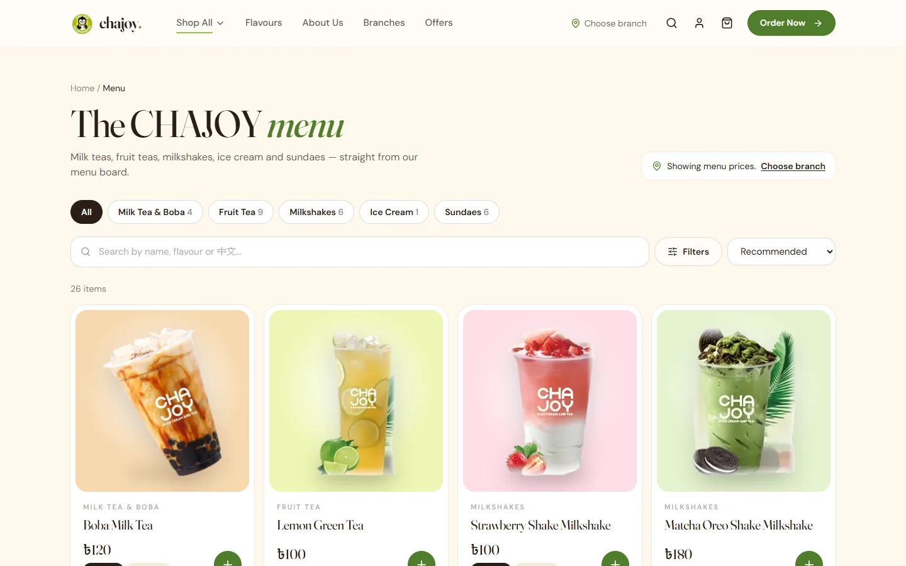
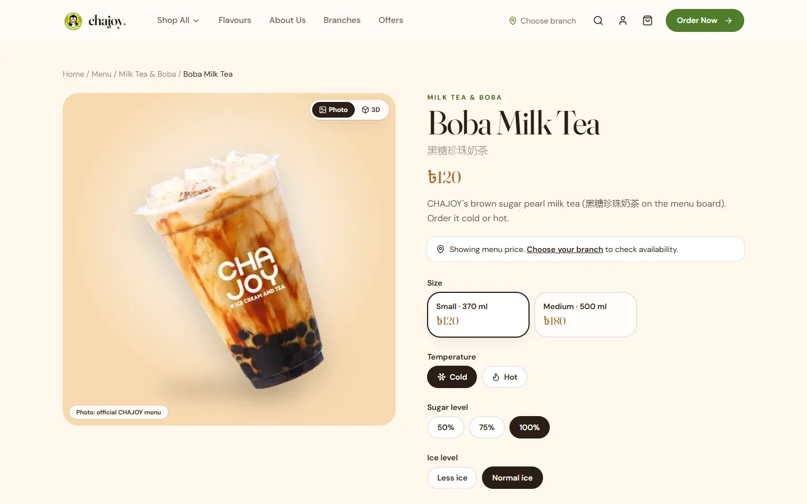
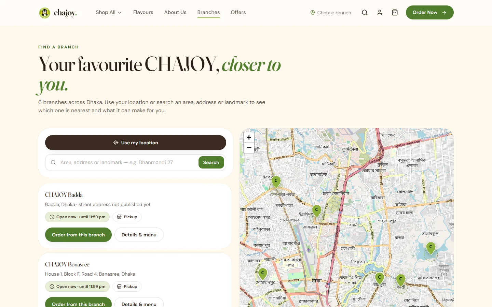

<div align="center">


# CHAJOY BD

**Online ordering and back office for CHAJOY — Ice Cream & Tea (চা জয়), Dhaka**

[](https://github.com/mahmudultopu/chajoy/actions/workflows/ci.yml)


[**Live site**](https://chajoy-bd.vercel.app) · [Architecture](docs/ARCHITECTURE.md) · [Operations guide](docs/OPERATIONS.md) · [Deployment](docs/DEPLOYMENT.md)


</div>

## Overview

CHAJOY BD is a full-stack storefront for a Dhaka bubble-tea and ice-cream chain. Customers browse the menu with **branch-specific prices and availability**, find their nearest branch, customise drinks (size, temperature, sugar, ice, toppings) and order for **pickup or delivery**. Staff run everything from a role-based **admin panel**: products, branches, stock, orders, promotions and site content.

Every product name, size and price comes from CHAJOY's official menu board. Details the business hasn't published (opening hours, delivery fees, exact branch locations, allergens) are left empty and flagged rather than guessed — see [docs/AUDIT.md](docs/AUDIT.md).

## Features

**Storefront**
- Menu with categories, search, filters and sorting; prices and availability follow the chosen branch
- Product pages with every option CHAJOY offers, a live price and an interactive 3D viewer
- Branch finder using device location or address search, ranked by distance *and* by whether the branch can make the order
- Cart and checkout for pickup or delivery, with a map pin for delivery addresses
- Order tracking by private link, or by order number and phone
- Customer accounts with order history, reorder and saved addresses

**Back office**
- Dashboard with sales, best sellers and a go-live checklist
- Products, sizes and prices, photos, categories and per-branch availability
- Branches: hours, location, delivery radius and fees, price overrides and stock
- Order workflow with enforced status transitions, cash collection and delivery details
- Promotions and discount codes, announcements, homepage copy and policy pages
- CSV import/export with a preview step, staff roles (owner, manager, branch staff) and a full audit log

**Engineering**
- Server-authoritative pricing in a single pure function (`quote()`); money stored as integer paisa
- Idempotent checkout and race-safe stock updates
- Strict security headers (CSP, HSTS, frame and opener policies), hashed session tokens, rate limiting and cross-site request checks
- Unit, database-integration and browser end-to-end tests

## Screenshots

| Menu | Product |
|---|---|
|  |  |
| **Branch finder** | **Mobile** |
|  | <p align="center"></p> |

## Tech stack

| Layer | Choice |
|---|---|
| Framework | Next.js 16 (App Router), React 19, TypeScript |
| Styling | Tailwind CSS 4 with design tokens in `src/app/globals.css` |
| Database | PostgreSQL with Drizzle ORM; embedded PGlite for local development and tests |
| Validation | Zod on every API body, server action and import row |
| Maps | Leaflet with OpenStreetMap; geocoding through a rate-limited server proxy |
| Payments | Cash on delivery / pickup; SSLCommerz (bKash, Nagad, cards) |
| 3D | three.js with React Three Fiber |
| Hosting | Vercel, Neon Postgres and Vercel Blob |
| Testing | Vitest and Playwright |

## Getting started

**Requirements:** Node.js 20.9 or newer. No database install is needed — local development uses an embedded Postgres stored in `.data/`.

```bash
git clone https://github.com/mahmudultopu/chajoy.git
cd chajoy
npm install
npm run db:setup                     # create tables and load the verified catalogue and branches
ADMIN_PASSWORD='choose-a-long-one' npm run admin:create -- --email you@example.com --name "Your Name"
npm run dev                          # http://localhost:3000 — admin at /admin
```

Nothing can be ordered out of the box, because no branch has published hours or delivery settings yet. To try the full ordering flow locally:

```bash
npm run db:demo-ops                  # sample hours, delivery and cash settings (a banner marks them)
npm run db:demo-ops -- --reset       # remove them again
```

> [!IMPORTANT]
> Stop `npm run dev` before running any `db:*` or `admin:*` script. The embedded database allows one process at a time. Production uses a regular Postgres server and has no such limit.

Copy `.env.example` to `.env.local` to configure Postgres, Vercel Blob, SSLCommerz and the public site URL. See [docs/DEPLOYMENT.md](docs/DEPLOYMENT.md).

## Scripts

| Command | Description |
|---|---|
| `npm run dev` · `build` · `start` | Develop, build and serve |
| `npm run typecheck` | Type-check the project |
| `npm test` | Unit and database-integration tests |
| `npm run test:e2e` · `test:e2e:admin` | Browser end-to-end tests (app running with sample settings) |
| `npm run db:migrate` · `db:generate` | Apply or create migrations |
| `npm run db:seed` | Refresh the catalogue and branches (keeps admin edits; `-- --force` overwrites) |
| `npm run db:check` | Database health check |
| `npm run admin:create` | Create or reset a staff account |

## Project structure

```
src/
  app/(store)/        storefront pages
  app/admin/          back office
  app/api/            JSON APIs: cart, checkout, branches, orders, payments, export
  components/         UI by area (home, menu, product, store, branches, checkout, admin, three)
  lib/                pricing, hours, geo, options, auth, payments, CSV import, services
data/                 verified catalogue and branch data
drizzle/              SQL migrations
public/images/        product photography, store photos and brand assets
scripts/              database, admin, end-to-end test and image pipeline scripts
tests/                Vitest suites
docs/                 architecture, operations, deployment and data audit
```

## Documentation

| Document | Contents |
|---|---|
| [ARCHITECTURE.md](docs/ARCHITECTURE.md) | Design decisions, data model, pricing, security |
| [OPERATIONS.md](docs/OPERATIONS.md) | Day-to-day: products, prices, branches, stock and orders |
| [DEPLOYMENT.md](docs/DEPLOYMENT.md) | Postgres, storage, hosting and go-live checklist |
| [AUDIT.md](docs/AUDIT.md) | Where every business fact came from |
| [REQUIRED-FROM-OWNER.md](docs/REQUIRED-FROM-OWNER.md) | Details and credentials still needed from CHAJOY |

## Integration status

| Integration | Status |
|---|---|
| Cash on delivery / at pickup | ✅ Working — enable in Admin → Settings |
| SSLCommerz (bKash, Nagad, cards) | 🟡 Implemented with server-side validation; awaiting merchant credentials for live testing |
| Maps and address search | ✅ Working (OpenStreetMap, Nominatim) |
| Email / SMS notifications | ⏳ Planned — needs a provider |
| Courier APIs | ⏳ Planned — staff can record a rider or tracking link today |

## Contributing

See [CONTRIBUTING.md](CONTRIBUTING.md). Please report security issues privately as described in [SECURITY.md](SECURITY.md).

## License

Proprietary — all rights reserved. See [LICENSE](LICENSE). CHAJOY name, logo and photography belong to CHAJOY.
